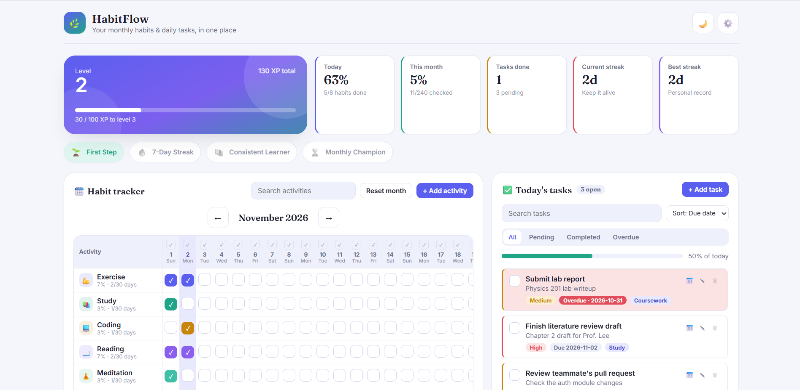
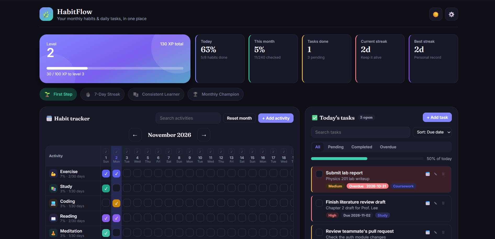

# 🌿 HabitFlow

A clean, responsive **monthly habit and daily task tracker** that runs entirely in your browser. No backend, no login, no build step: open one HTML file and start tracking.



## Features

### Monthly habit tracker
- Month selector with previous/next buttons. Every month shows the correct number of days (28, 29 in leap years, 30 or 31).
- Activities as rows, days as columns, with a **sticky activity column** that stays visible while you scroll horizontally.
- Day number and weekday on every column, with **today's column highlighted**.
- Per-activity completion percentage and total completed days, plus the overall monthly percentage and checked/unchecked totals.
- Add, edit and delete activities, each with its own **icon and color**. Eight defaults are included (Exercise, Study, Coding, Reading, Meditation, Sleep, Water, Personal).
- One-click **"toggle whole day"** button to mark every activity complete (or clear it) for a given day.
- **Reset month** button with a confirmation prompt.
- Every month is stored separately. Browsing to a month with no data gives you a fresh empty checklist, and previous months are never overwritten.

### Daily tasks
- Add tasks with a title, optional description, priority (Low / Medium / High), due date and category.
- Edit, delete, complete, and **move a task to another date**.
- Overdue tasks are clearly highlighted.
- Filter by **All / Pending / Completed / Overdue**, sort by due date or priority, and search by title, description or category.
- Progress bar, completed/pending counts, and a **Clear completed** button (with confirmation).
- Friendly empty state when there is nothing to show.

### Dashboard and charts
- Summary cards: today's completion, monthly completion, tasks done/pending, current streak, best streak.
- Monthly progress bar, a last-7-days bar chart, and a per-category task progress chart.
- **Year in review**: a heatmap of all 12 months at once, with active days, average completion, best month and longest streak. Use the year arrows to look back at earlier years.

### Gamification
- **10 XP** for every completed habit checkbox and **20 XP** for every completed task. Every 100 XP is a level.
- Achievement badges, with a subtle confetti burst when one unlocks:

| Badge | How to unlock |
| --- | --- |
| 🌱 First Step | Complete your first activity |
| 🔥 7-Day Streak | Reach a 7-day streak |
| 📚 Consistent Learner | Complete **Study** for 7 days in a row |
| 🏆 Monthly Champion | Reach 80% completion in any month |

### Data and settings
- Everything is saved in your browser's `localStorage`, so it survives refreshes and restarts.
- **Export** all data as JSON, **import** it back, restore the sample data, or **clear everything** (strong confirmation).
- Light and dark themes, search, and a compact mobile layout.

## Screenshots

| Dark mode | Mobile |
| --- | --- |
|  |  |

## Getting started

There is nothing to install.

```bash
git clone https://github.com/<your-username>/<your-repo>.git
cd <your-repo>
# then just open index.html in your browser
```

> **Internet connection:** the page loads React, ReactDOM and Babel from the cdnjs CDN and the Fraunces and Inter fonts from Google Fonts. You need to be online the first time you open it (browsers usually cache these afterwards).

### Host it free on GitHub Pages
1. Push the project to GitHub.
2. Go to **Settings → Pages**.
3. Under **Build and deployment**, choose **Deploy from a branch**, select `main` and `/ (root)`, then save.
4. Your tracker will be live at `https://<your-username>.github.io/<your-repo>/`.

## How it works

- **Storage:** one JSON object under the key `habitflow_data_v2` holds activities, a `monthlyData` map keyed by `YYYY-MM`, tasks, settings, achievements and best streak.
- **XP and level** are calculated from the data on every render (not stored), so unchecking a box can never leave XP out of sync.
- **Current streak** counts consecutive days with at least one habit checked, ending today (or yesterday if you haven't checked anything yet today). **Best streak** is the highest value ever reached.
- **Achievements** are re-checked after every change and only ever unlock, never lock again.

## Tech stack

- [React 18](https://react.dev/) (functional components and hooks), loaded via CDN
- [Babel Standalone](https://babeljs.io/docs/babel-standalone) for in-browser JSX
- Plain CSS with CSS variables for theming
- `localStorage` for persistence

## Project structure

```
.
├── index.html        # the entire app (HTML + CSS + React)
├── screenshots/      # images used in this README
└── README.md
```

## Known limitations

- Data lives in one browser on one device. Use **Export / Import** to move it or back it up.
- Best streak is a running maximum, not a full history of past streaks.
- Because React and Babel load from a CDN, the app needs a connection on first load.

## Ideas for the future

- A full streak history with a calendar heatmap per activity
- Recurring and templated daily tasks
- Per-activity weekly goals (for example, Exercise only on Mon/Wed/Fri)
- CSV export alongside JSON
- Optional cloud sync

## License

Add a license of your choice (for example [MIT](https://choosealicense.com/licenses/mit/)) before publishing.
